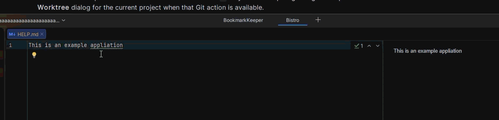

# Project Tab Bar for IntelliJ IDEA

Adds tabs to the toolbar so you can switch between open projects.

* Has a settings menu to specify how the tabs should be named under "Settings -> Tools -> Project Tab Bar"